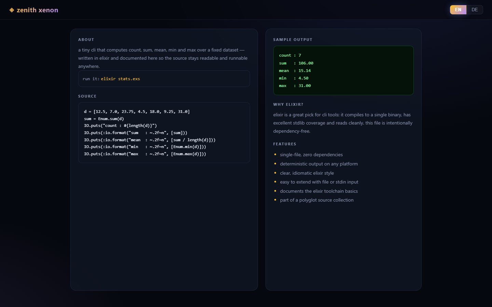
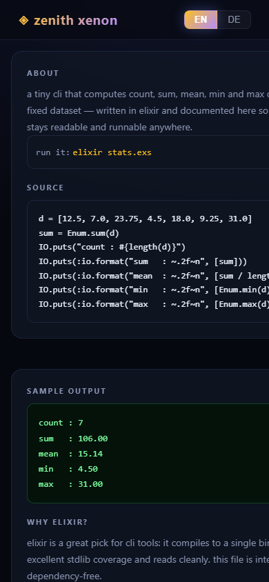

# Zenith Xenon — elixir Stats Cli

A dependency-free elixir CLI that computes count, sum, mean, min and max — with readable source, run instructions and sample output, presented as a polished static report.

<div align="center">


-orange)


**[Live Demo](https://ruslanfridenli.github.io/zenith-xenon/)** · **[Deutsch ↓](#-deutsch)**

</div>

---

## Screenshots






## Features

- Written in elixir
- zero dependencies, single file
- deterministic sample output
- run instructions for elixir stats.exs
- polished static documentation page
- English/German interface

## Local development

```bash
git clone https://github.com/ruslanfridenli/zenith-xenon.git
cd zenith-xenon
# open index.html in a browser, or serve statically:
npx serve .
```

No build step, no dependencies — pure static site.

---

## 🇩🇪 Deutsch

### Zenith Xenon — elixir Stats Cli

Ein abhängigkeitsfreies elixir-CLI, das count, sum, mean, min und max berechnet — mit lesbarem Quelltext, Ausführungsanleitung und Beispiel-Ausgabe als polierte statische Doku.

### Funktionen

- Geschrieben in elixir
- keine abhängigkeiten, eine datei
- deterministische beispiel-ausgabe
- ausführungsanleitung: elixir stats.exs
- polierte statische dokumentationsseite
- Englische/deutsche Oberfläche

### Lokale Entwicklung

```bash
git clone https://github.com/ruslanfridenli/zenith-xenon.git
cd zenith-xenon
npx serve .
```

Reine statische Seite — kein Build-Schritt, keine Abhängigkeiten.

---

## ☕ Support / Unterstützen

Wenn dir diese Website beim Lernen hilft, würde mir eine Spende sehr viel bedeuten und dabei helfen, sie weiterzuentwickeln. Alternativ kannst du das Projekt mit einem Stern im github repo unterstützen. Vielen Dank!

- Solana: `zQpgZ6nGigww7vYpz3Qqxb1BT44kqS567vFaLTeHagS`
- Ethereum: `0x9c4fE1B2e9a1A9c22312c8296BB088Ca0e8F1B4e`
- Bitcoin: `bc1p2jltk9ya9kyzv35d8kxn7mmg9jqkx66cqtgzqwe75zlr4v9jk4hsv468q7`

---

Made with care. Feedback welcome via issues.
